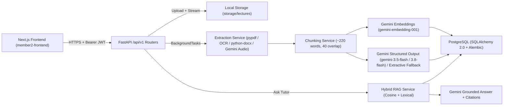

# System Architecture

## High-Level Backend & AI Pipeline

## Module Layout (`backend/app/`)

- **`core/`**:
  - `config.py` — Pydantic `Settings` loading `backend/.env`, validating production `SECRET_KEY`, resolving upload directories and CORS origins.
  - `security.py` — `bcrypt` password hashing (with 72-byte guard) and HS256 JWT issuance/verification.
  - `dependencies.py` — `OAuth2PasswordBearer` (`get_current_user`) enforcing active user checks.
  - `rate_limit.py` — Thread-safe sliding-window rate limiter protecting auth endpoints.
- **`db/` & `models/`**:
  - Synchronous SQLAlchemy 2.0 session factory with `pool_pre_ping=True` and deterministic constraint naming (`NAMING_CONVENTION`).
  - ORM models: `User`, `Document`, `LectureChunk`, `Flashcard`, `Quiz`, `QuizQuestion`, `QuizAttempt`, `TutorMessage`, `StudyActivityLog`.
- **`services/`**:
  - `extraction_service.py` — Page-level PDF extraction (`pypdf`) with scanned-page OCR fallback (`pytesseract` + `Pillow` or Gemini multimodal), DOCX section parsing (`python-docx`), TXT reading, and Gemini audio/video transcription.
  - `chunking_service.py` — Overlapping word-bounded RAG chunking preserving segment references.
  - `gemini_service.py` — Structured JSON generation via `google-genai` (`GeneratedStudyBundle`, `GeneratedTranscript`), batch embeddings, image OCR, and extractive offline fallback when `GEMINI_API_KEY` is unset.
  - `rag_service.py` — Multi-tenant (`user_id`-isolated) hybrid semantic + lexical retrieval returning source citations.
  - `spaced_repetition.py` — Server-side SM-2 interval and mastery scheduler.
  - `lecture_processor.py` — Background pipeline orchestrating ingestion, chunk indexing, and study artifact persistence.
- **`api/`**:
  - `auth.py`, `lectures.py`, `flashcards.py`, `quizzes.py`, `tutor.py`, `progress.py`.
