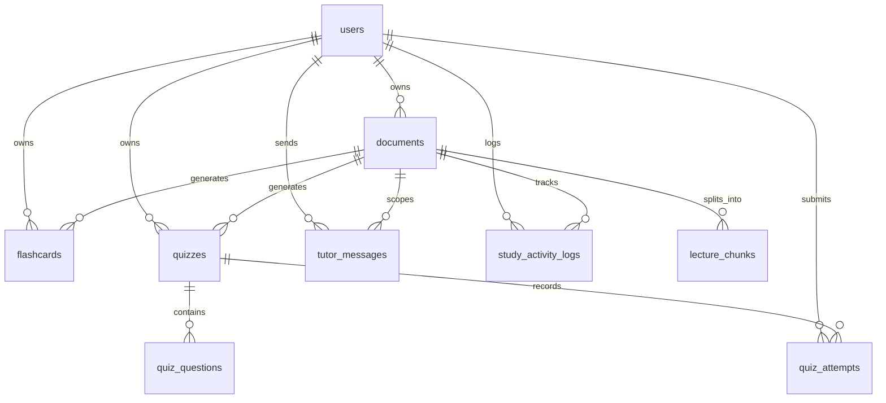

# Database Schema

The PostgreSQL schema is managed with Alembic (`backend/alembic/versions/`).

## Entity Relationship Diagram

## Tables

| Table | Purpose | Key Columns |
| :--- | :--- | :--- |
| `users` | Registered accounts | `id`, `name`, `email` (unique), `password_hash`, `is_active`, `created_at` |
| `documents` | Uploaded lectures & generated summary/concept map | `id`, `user_id`, `title`, `subject`, `filename`, `content_type`, `source_type`, `duration`, `file_size`, `storage_path`, `status`, `progress`, `error_message`, `targets` (`JSONB`), `extracted_text`, `summary`, `key_takeaways` (`JSONB`), `segments` (`JSONB`), `concept_nodes` (`JSONB`), `concept_edges` (`JSONB`), `created_at`, `updated_at` |
| `lecture_chunks` | RAG chunks & embedding vectors | `id`, `document_id`, `user_id`, `chunk_index`, `segment_id`, `label`, `reference`, `text`, `embedding` (`JSONB`) |
| `flashcards` | Active-recall cards & SM-2 state | `id`, `user_id`, `document_id`, `front`, `back`, `hint`, `mastery`, `ease_factor`, `interval_days`, `repetitions`, `next_review_at`, `next_review_label` |
| `quizzes` | Generated practice quizzes | `id`, `user_id`, `document_id`, `title`, `difficulty`, `estimated_minutes` |
| `quiz_questions` | Multiple-choice questions | `id`, `quiz_id`, `question_index`, `question`, `options` (`JSONB`), `correct_index`, `explanation`, `source_ref` |
| `quiz_attempts` | Submitted answers & grades | `id`, `user_id`, `quiz_id`, `answers` (`JSONB`), `correct_count`, `total_questions`, `score_percent`, `elapsed_seconds` |
| `tutor_messages` | Persisted AI Tutor history | `id`, `user_id`, `document_id` (nullable), `role`, `content`, `citations` (`JSONB`) |
| `study_activity_logs` | Daily study telemetry | `id`, `user_id`, `document_id` (nullable), `activity_type`, `duration_seconds`, `cards_count`, `created_at` |

## Migration Chain

1. `1d074ad79086` — Create `users` and `documents` tables
2. `f6c27b714e55` — Empty placeholder revision
3. `805211b865f1` — Update `documents` ownership & file metadata columns
4. `d1bafd458d05` — Empty placeholder revision
5. `541c20a9303c` — Add `storage_path` column to `documents`
6. `9c2e4f1a8b7d` — Align `documents` & `users` schema with v1 lecture contracts & add `ix_documents_user_id`
7. `4f8a9d2c1b0e` — Create `lecture_chunks`, `flashcards`, `quizzes`, `quiz_questions`, `quiz_attempts`, `tutor_messages`, and `study_activity_logs`
